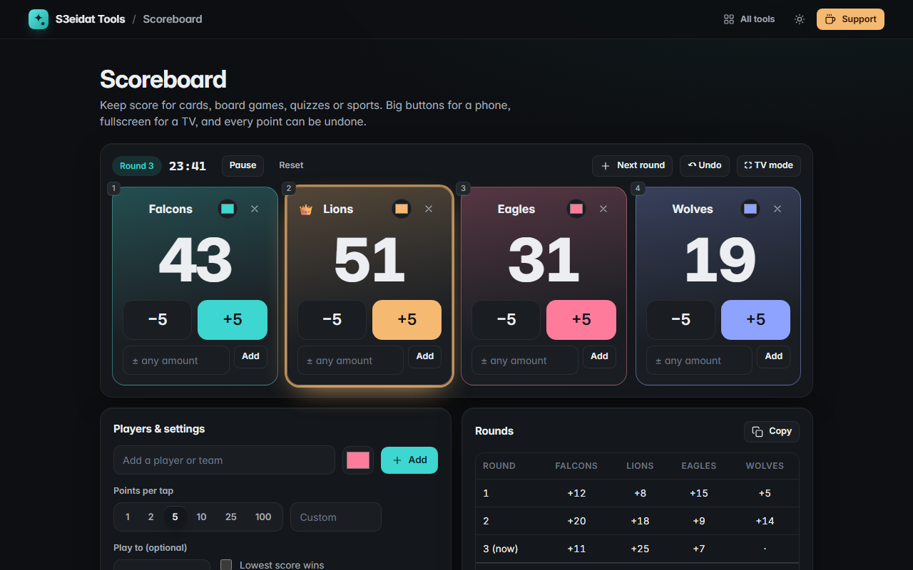

# Scoreboard

> A big, simple score keeper for any game. Free, private, and it runs entirely in your browser.

### ▶ [Open Scoreboard](https://s3eidat.github.io/scoreboard/)



## Features

- Add **players or teams** with their own colours; rename them right on the board
- Big **+ / −** buttons with a points-per-tap setting (1, 2, 5, 10, 25, 100 or custom), plus an any-amount box per player
- **Rounds** table with per-round points and totals; a log of every change and **undo** (<kbd>Ctrl</kbd>+<kbd>Z</kbd>)
- **Leader highlighted** with a crown, "lowest score wins" mode, and an optional target score
- **Game timer**, accurate even if the tab sleeps
- **TV mode** (fullscreen) with huge numbers; works great on a phone too
- Keyboard: <kbd>1</kbd>–<kbd>9</kbd> add points to a player, <kbd>Shift</kbd>+number subtracts, <kbd>N</kbd> next round
- Everything is saved, so a refresh never loses the game

## Privacy

The game is saved only in your browser (localStorage). There is no server, no account, no analytics.
The page ships with a strict Content-Security-Policy (`connect-src 'self'`), so the browser
itself blocks any attempt to send data anywhere.

## Run it yourself

It's plain HTML, CSS and JavaScript with no build step:

```bash
git clone https://github.com/s3eidat/scoreboard
cd scoreboard
python -m http.server 8000
```

Then open http://localhost:8000.

## Support

If this saved you time, **[buy me a coffee ☕](https://s3eidat.github.io/coffee/)**. It keeps every tool free.

---

Part of **[S3eidat Tools](https://s3eidat.github.io/)**: 100+ free, private tools that run in your browser. MIT licensed.
